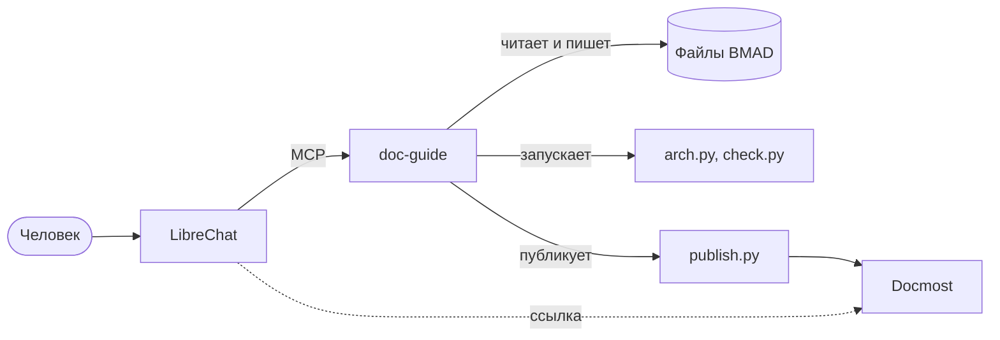

# Хелперы документации в LibreChat

Статус: **реализовано, диалог с моделью не проверен**.

## Задача

Человек дозаполняет и проверяет документацию BMAD. Ему нужно видеть, что отсутствует, какие блоки создать и в каком порядке, какие вопросы задать и как описать результат. Работать он хочет в LibreChat, а документацию видеть через Docmost.

## Что проверено

Проверялось на установленных версиях, а не только по публикациям.

| Вопрос | Факт | Как проверено |
| --- | --- | --- |
| Подключит ли LibreChat своё MCP | Да: `mcpServers` в `librechat.yaml`, транспорт `streamable-http`, инструменты видны агентам | Документация LibreChat |
| Умеет ли он показывать интерфейс из результата инструмента | Да: в v0.8.8 есть `ui_resources` и `UIResourceRenderer` из mcp-ui | Поиск в сборке работающего контейнера |
| Поддерживает ли официальный стандарт MCP Apps | Не подтверждено: запрос и PR были открыты, в сборке признаков `ui://` как основного пути не найдено | Поиск по сборке, GitHub |
| Покажется ли Docmost внутри LibreChat | Нет: ответ содержит `X-Frame-Options: SAMEORIGIN`, а источники разные | Заголовки `localhost:3100` |
| Есть ли у Docmost свой MCP и API-ключи | Есть, но только в платной лицензии Enterprise | Документация Docmost, папки `ee` в контейнере |
| Видят ли контейнеры друг друга | Нет: сети `docmost_default` и `llm-stack_default` разные | `docker network ls` |

LibreChat показывает результат инструмента во врезке, а не в боковой панели. Встроить стороннее приложение в панель Artifacts штатно нельзя: она показывает только то, что сгенерировала модель.

Уточнение при реализации: LibreChat принимает из ресурсов MCP только `rawHtml`. Внешний адрес через `text/uri-list` он отвергает, а HTML работает в песочнице без своего источника, поэтому Docmost внутри карточки не получит авторизацию.

Выбранный способ: nginx перед LibreChat добавляет скрипт с кнопкой и боковой панелью Docmost, а карточка из чата просит панель открыть страницу через `postMessage`. Код LibreChat не меняется.

## Что говорят публикации

- Разделение ролей работает лучше одной модели: один агент ведёт опрос, другой проверяет спецификацию на пробелы (ASK).
- Явная матрица пробелов (нет, частично, неоднозначно, противоречит) превращает находки в точные вопросы и улучшает полноту (ACDP).
- Модели плохо вытягивают неявные требования: лучший результат 0,32 (ReqElicitGym). Опрос не заменяет человека.
- Модели находят много, но с избытком, люди точнее. Это совпадает с нашей калибровкой G01.

Вывод: **что отсутствует и что делать дальше считает скрипт, модель только формулирует вопрос и черновик, решает человек.**

## Варианты подключения

| Вариант | Плюсы | Минусы | Вывод |
| --- | --- | --- | --- |
| A. Своё MCP с карточками `ui_resources`, переход в Docmost по ссылке | Работает на текущих версиях, без правки чужого кода и без лицензий | Docmost открывается в отдельной вкладке | **Рекомендую** |
| B. A плюс Docmost внутри LibreChat через обратный прокси, снимающий запрет показа | Документация видна прямо в чате | Прокси снимает защиту от кликджекинга, нужны единый вход и общий адрес | Опционально, только локально |
| C. Показывать страницы своей HTML-сборкой в карточке | Без прокси, вид полностью наш | Второй вид помимо Docmost | Для коротких сводок, не для всей документации |
| D. MCP самого Docmost | Готово | Платная лицензия | Отклонён |
| E. Правка кода LibreChat | Любая панель | Каждое обновление ломает правку | Отклонён |

## Устройство

`doc-guide` один, это сервер с общим движком пробелов. `rnd-helper` и `sdd-helper` остаются отдельными наборами: порядок шагов, вопросы и шаблоны для своей работы. Так выполнено прежнее решение об отдельных подпроектах и нет двух движков.

## Источники

- [LibreChat: mcpServers](https://www.librechat.ai/docs/configuration/librechat_yaml/object_structure/mcp_servers)
- [LibreChat: Artifacts](https://www.librechat.ai/docs/user_guides/artifacts)
- [LibreChat: RFC MCP Apps](https://github.com/danny-avila/LibreChat/discussions/11581), [PR 11799](https://github.com/LibreChat-AI/LibreChat/pull/11799)
- [SEP-1865 MCP Apps](https://modelcontextprotocol.io/community/seps/1865-mcp-apps-interactive-user-interfaces-for-mcp)
- [Docmost: MCP](https://docmost.com/docs/user-guide/mcp)
- [ASK, ESEM 2026](https://drops.dagstuhl.de/entities/document/10.4230/LIPIcs.ESEM.2026.82)
- [ReqElicitGym](https://arxiv.org/html/2602.18306v1)
- [LLMREI](https://arxiv.org/pdf/2507.02564)
